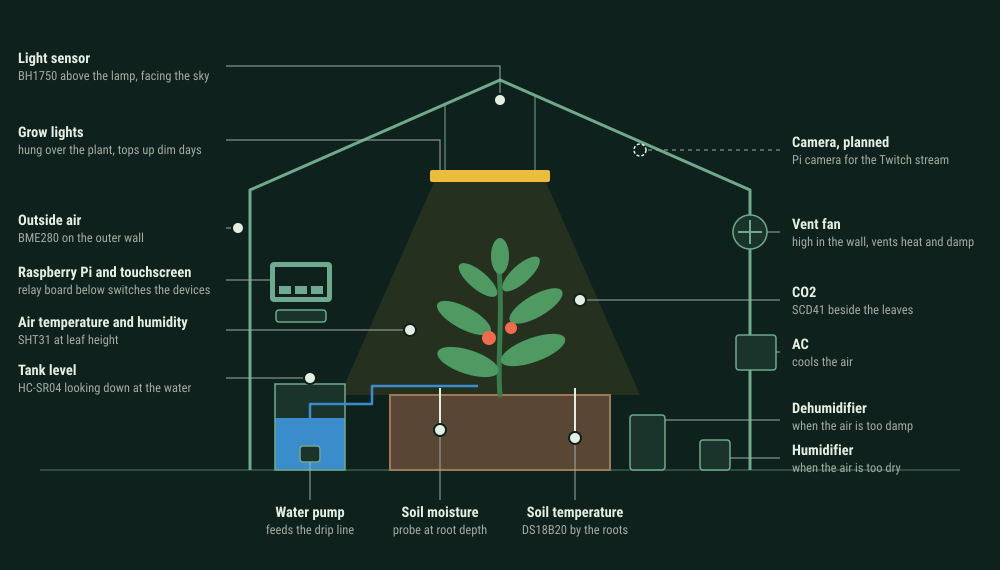
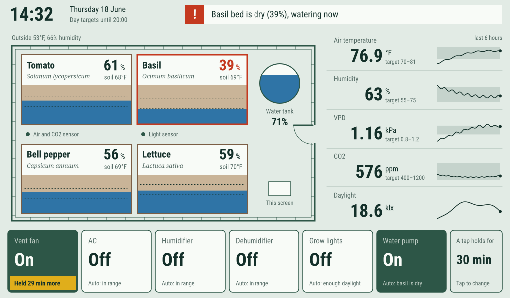

# greenhouse-pi

A Raspberry Pi with a 7-inch touchscreen that watches the plants in a small
greenhouse and runs the fan, AC, humidifier, dehumidifier, grow lights and
water pump for them.





The second picture is the real dashboard drawn from simulated readings, not a
mock-up kept by hand. `python -m greenhouse.preview` redraws it.

## The screen

- **Beds.** The greenhouse from above. Each bed fills with blue to the level
  of its soil moisture, and the two dashed lines mark the range that crop
  wants. A bed that needs water gets a red edge.
- **Air.** Temperature, humidity, VPD, CO2 and daylight, each with its target
  for the current time of day and a trace of the last six hours. The shaded
  band in a trace is the target range.
- **Switches.** Each one shows whether the device is on and why. Tap one to
  hold it the other way, tap again to flip the hold, tap a third time to hand
  it back to automation. A hold also ends on its own; the plate at the far
  right sets how long that takes (15 min, 30 min, 1 h or 3 h).
- **Top line.** The one thing that most needs a person, or "Everything is in
  range".

## Try it without a Pi

Needs Python 3.11 or newer with Tkinter, and nothing else.

```
python -m greenhouse --sim --window
```

## On the Pi

Turn on I2C and 1-Wire in `raspi-config`, then:

```
sudo apt install python3-tk fonts-ibm-plex
pip install -r requirements-pi.txt
python -m greenhouse
```

It opens full screen. Screens that are not 1024x600 get the same layout
scaled to fit. Escape quits and switches every relay off.

| Part | Reads | Connection |
| --- | --- | --- |
| SHT31 | Air temperature and humidity | I2C 0x44 |
| SCD41 | CO2 | I2C 0x62 |
| BH1750 | Daylight | I2C 0x23 |
| BME280 | Outside temperature and humidity | I2C 0x76 |
| ADS1115 + 4 capacitive probes | Soil moisture, one per bed | I2C 0x48 |
| DS18B20 x 4 | Soil temperature, one per bed | 1-Wire |
| HC-SR04 | Water tank level | GPIO 23 and 24 |
| 6-channel relay board | Switches the six devices | GPIO 5, 6, 13, 19, 26, 21 |

The HC-SR04 echo pin is 5 V and needs a divider before it reaches the Pi.
Mount the light sensor where the grow lights do not shine on it, or the
lights will switch themselves off.

A sensor that is missing or stops answering shows "no reading" and is named
on the top line. The device that depends on it stays off until it is back.

## Settings

Everything is in [`greenhouse.toml`](greenhouse.toml): the beds and their
crops, targets for day and night, watering hours, hold lengths, probe
calibration and pin numbers.

## What automation does

| Device | Turns on when |
| --- | --- |
| AC | Air is above the temperature target |
| Vent fan | Air is within 1 °C of the top of the target and cooler outside, or humidity is over target, or CO2 has dropped under target |
| Humidifier | VPD is above target (air too dry) |
| Dehumidifier | VPD is below target (air too damp) |
| Grow lights | Daylight is under 10 klx during lighting hours |
| Water pump | A bed is under its moisture range during watering hours. Runs 90 s, then waits 30 min |

Automatic switches are at least two minutes apart. The pump never runs with
the tank under 15%, and a pump held on by hand is cut off after five minutes.

## Tests

```
python -m unittest
```

## Not done yet

- The sensor and relay drivers in `greenhouse/sensors.py` and
  `greenhouse/relays.py` have not been run against real hardware yet. The
  simulated mode, the automation and the screen have.
- Twitch streaming from the Pi camera.
- Readings are kept in memory for the traces and are lost on restart.

## Author

**Jeffrey Smith** - Github: [jsmith1031](https://github.com/jsmith1031)

Licensed under the GPL v3, see [LICENSE](LICENSE).
